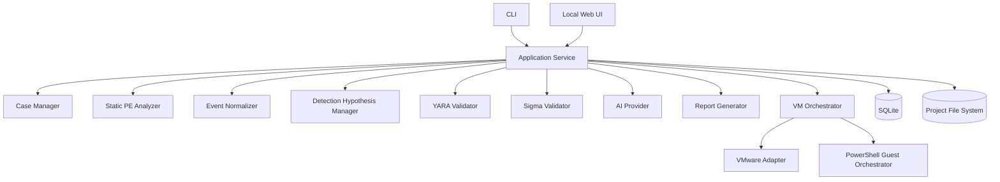
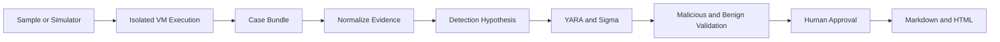

# 시스템 아키텍처

## 1. 아키텍처 목표

- CLI와 로컬 웹 UI가 같은 코어를 사용한다.
- VM 자동화가 실패해도 수동 Case Bundle로 핵심 기능을 사용할 수 있다.
- AI Provider가 없어도 핵심 파이프라인이 작동한다.
- Hypervisor, Guest Agent, AI Provider를 교체 가능하게 분리한다.
- 원본 자료와 메타데이터를 분리하되 무결성을 연결한다.

## 2. 구성요소

## 3. 주요 모듈

### Application Service
CLI와 웹 UI에서 호출하는 공통 유스케이스 계층이다.

### Case Manager
케이스 생성, 상태 전이, 자료 등록, 작업공간 경로를 관리한다.

### Static PE Analyzer
PE 정적 특징을 수집하고 YARA 검증 입력을 준비한다.

### Event Normalizer
Sysmon과 선택 로그를 공통 스키마로 변환한다.

### Detection Hypothesis Manager
정적·동적 증거, YARA·Sigma, 정상 반례, 한계점을 하나의 가설로 연결한다.

### Rule Validator
YARA와 Sigma의 문법, 실행, 결과, 버전을 관리한다.

### AI Provider
Manual, Mock, External API, Local LLM 구현을 교체할 수 있는 인터페이스이다.

### Report Generator
공통 보고서 모델에서 Markdown, 독립형 HTML, 정적 사이트를 생성한다.

### VM Orchestrator
분석 VM 복원, 시작, 샘플 전달, 수집, 결과 회수, 종료를 담당한다.

## 4. 핵심 데이터 흐름

## 5. 실패 격리

- VM 자동화 실패는 오프라인 코어 기능을 막지 않아야 한다.
- AI Provider 실패는 수동 입력으로 대체되어야 한다.
- Procmon·PCAP 실패는 Sysmon·정적 분석 케이스 생성을 막지 않아야 한다.
- 보고서 생성 실패는 원본 분석 데이터와 검증 결과를 손상시키지 않아야 한다.
