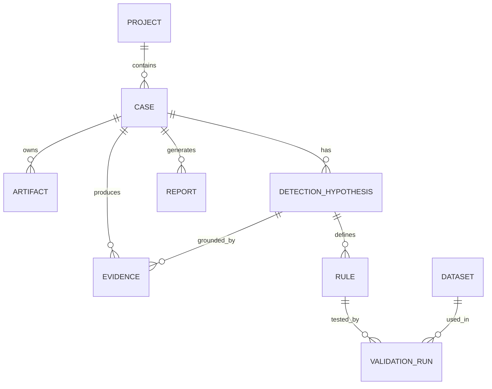

# 데이터 모델과 작업공간

## 1. 작업공간 구조

```text
LoaderDetectionProject/
├─ project.db
├─ project.json
├─ cases/
│  └─ CASE-001/
│     ├─ sample/
│     ├─ static/
│     ├─ sysmon/
│     ├─ procmon/
│     ├─ network/
│     ├─ normalized/
│     └─ evidence/
├─ datasets/
│  ├─ benign-common/
│  └─ benign-counterparts/
├─ rules/
│  ├─ yara/
│  └─ sigma/
├─ validation/
├─ reports/
│  ├─ markdown/
│  ├─ standalone/
│  └─ site/
└─ publication/
```

## 2. 주요 엔터티

### Project
프로젝트 이름, 버전, 생성일, 루트 경로, 정책을 저장한다.

### Case
분석 단위이다. 악성 샘플, 시뮬레이터, 정상 비교 케이스를 구분한다.

### Artifact
샘플, 로그, PCAP, 보고서, 룰 등 파일 산출물이다. 상대 경로와 SHA-256을 가진다.

### Evidence
정적 특징 또는 정규화 이벤트 중 탐지 가설에 사용된 근거이다.

### DetectionHypothesis
분석 결론의 중심 엔터티이다. YARA와 Sigma를 하나의 가설 아래 연결한다.

### Rule
YARA 또는 Sigma 룰의 버전별 본문, 상태, 작성자, 생성 방식을 저장한다.

### Dataset
악성, 공통 정상, 사례별 정상 대응 데이터셋을 구분한다.

### ValidationRun
특정 룰 버전과 특정 데이터셋 버전의 시험 결과이다.

### Report
케이스 보고서의 Markdown·HTML 산출물과 생성 시점을 기록한다.

### AIInteraction
선택 기능이다. Provider, 입력 증거 범위, 출력, 승인 여부를 기록한다.

### Case Bundle v1
Case Bundle은 `project.json`과 SQLite를 포함하지 않는 단일 Case 교환 패키지다.
`manifest.json`은 Case snapshot, attached Artifact metadata, unique content 목록과
`public < internal < restricted` classification을 기록한다. 물리 바이트는
`artifacts/sha256/<두 자리>/<sha256>`에 한 번만 저장하며, import 시 Case와
Artifact ID·timestamp·lifecycle은 보존하고 target Project ID로 rebinding한다.

## 3. 관계



## 4. 파일 상태

```yaml
collection_coverage:
  static_pe:
    status: collected
  sysmon:
    status: collected
  procmon:
    status: not_required
    reason: "Sysmon으로 필요한 행위를 확인함"
  pcap:
    status: not_applicable
    reason: "분석 구간에 네트워크 행위가 없음"
```

허용 상태는 다음과 같다.

- `collected`
- `not_required`
- `not_applicable`
- `collection_failed`
- `not_configured`

## 5. 경로와 무결성

- DB에는 프로젝트 루트 기준 상대 경로를 저장한다.
- 모든 등록 파일은 SHA-256을 가진다.
- 결과 회수 전후 해시를 비교한다.
- 공개 번들에는 원본 자료 대신 정제 사본의 해시를 기록한다.
